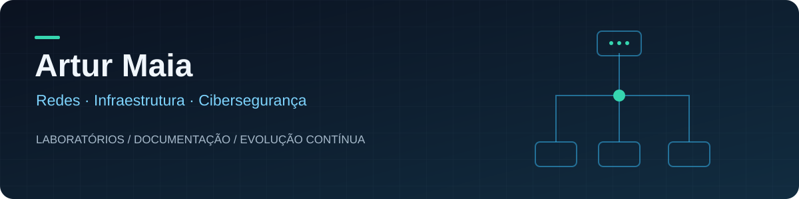

 

**Laboratórios práticos · Infraestrutura documentada · Testes com evidências**

Construindo minha trajetória em redes e cibersegurança, um laboratório de cada vez.

[Laboratório de redes](https://github.com/artur2774/enterprise-network-lab) &nbsp; • &nbsp; [Monitoramento](https://github.com/artur2774/network-monitoring-lab) &nbsp; • &nbsp; [Todos os projetos](https://github.com/artur2774?tab=repositories)

---

## Olá, sou o Artur

Desenvolvo laboratórios de **redes, infraestrutura e segurança**, com foco em entender a configuração, testar o comportamento e documentar os resultados. Meu ambiente reúne **Hyper-V, OPNsense e Linux**, da segmentação de redes ao monitoramento operacional.

Também compartilho projetos de desenvolvimento web e estudos realizados na FIAP.

## Projetos em destaque

<table>
<tr>
<td width="50%" valign="top">

### 01 · Enterprise Network Lab

**Segmentação e controle de acesso**

Rede empresarial simulada com VLANs para funcionários, servidores e visitantes. Regras de firewall, DHCP, DNS e testes de conectividade documentados.

**Hyper-V · OPNsense · Ubuntu · WireGuard**

✓ Segmentação e controle de acesso IPv4 validados  
✓ HTTP e SSH pela VPN em teste interno  
✓ Evidências de permissões e bloqueios

[**Explorar laboratório →**](https://github.com/artur2774/enterprise-network-lab)

</td>
<td width="50%" valign="top">

### 02 · Network Monitoring Lab

**Visibilidade e resposta a falhas**

Monitoramento de Ubuntu Server e OPNsense com Zabbix, incluindo métricas, dashboard e um teste controlado de falha e recuperação do agente.

**Zabbix · PostgreSQL · Linux · OPNsense**

✓ Hosts com métricas recentes  
✓ Problema e recuperação registrados no Zabbix  
✓ Administração por WireGuard e túnel SSH

[**Explorar monitoramento →**](https://github.com/artur2774/network-monitoring-lab)

</td>
</tr>
</table>

> **Escopo dos laboratórios:** o acesso WireGuard foi validado pela rede doméstica; acesso pela internet ainda está pendente. No monitoramento, o teste realizado foi a parada do agente, com alerta na interface do Zabbix.

## Tecnologias na prática

| Área | Tecnologias e conceitos aplicados |
| :--- | :--- |
| **Redes** | VLANs, roteamento, DHCP, DNS e NAT |
| **Segurança** | OPNsense, regras de firewall, isolamento IPv4 e WireGuard |
| **Sistemas** | Hyper-V, Windows Server, Ubuntu Server e Kali Linux |
| **Monitoramento** | Zabbix, agentes, métricas, dashboards e eventos |
| **Serviços** | Nginx, Apache, OpenSSH e PostgreSQL |

## Como organizo meus projetos

**Configurar → Testar → Registrar → Evoluir**

- Documentação da topologia, dos serviços e das decisões de configuração.
- Validação com testes de conectividade, logs e evidências visuais.
- Registro dos limites de cada cenário e das próximas etapas.

<strong>Próximas evoluções dos laboratórios</strong>

- Validar acesso WireGuard pela internet.
- Restringir a administração a um cliente ou a uma rede de gestão.
- Ampliar a matriz de testes e as capturas de tráfego.
- Expandir o monitoramento de serviços e configurar notificações externas.

---

Artur Maia · Redes, infraestrutura e cibersegurança em prática.

